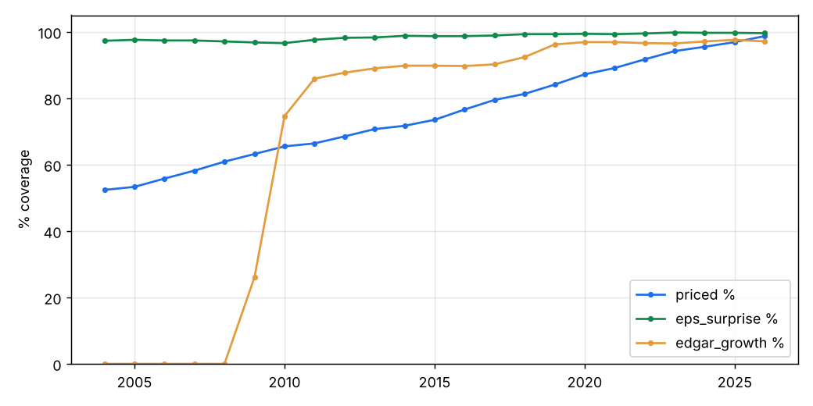

# Data coverage — how much of the point-in-time S&P 500 can the research see?

993 different companies were S&P 500 members at some point since 2004; 690 have Yahoo price history, 303 do not (almost all delisted or acquired — the survivorship bias that remains).

- **priced %** — of the day's index members, how many have price data (the rest are invisible to the backtest; they were disproportionately the companies that later failed or were bought).
- **eps surprise %** — of priced members, how many have a known consensus-vs-reported EPS surprise (Yahoo, ~2005+) from the last 200 days.
- **edgar growth %** — of priced members, how many have point-in-time YoY revenue growth from SEC filings (machine-readable filings start 2009-2011).

| Year | Members | Priced | Priced % | EPS surprise % | EDGAR growth % |
|---|---|---|---|---|---|
| 2004 | 495 | 259 | 52.4 | 97.3 | 0.0 |
| 2005 | 496 | 264 | 53.3 | 97.6 | 0.0 |
| 2006 | 497 | 277 | 55.8 | 97.4 | 0.0 |
| 2007 | 497 | 289 | 58.2 | 97.4 | 0.0 |
| 2008 | 497 | 303 | 60.9 | 97.1 | 0.0 |
| 2009 | 499 | 315 | 63.2 | 96.8 | 26.1 |
| 2010 | 498 | 326 | 65.5 | 96.6 | 74.6 |
| 2011 | 497 | 330 | 66.4 | 97.6 | 85.9 |
| 2012 | 497 | 341 | 68.5 | 98.2 | 87.7 |
| 2013 | 497 | 351 | 70.7 | 98.3 | 89.0 |
| 2014 | 498 | 357 | 71.7 | 98.8 | 89.8 |
| 2015 | 501 | 368 | 73.5 | 98.7 | 89.8 |
| 2016 | 505 | 387 | 76.6 | 98.7 | 89.7 |
| 2017 | 506 | 402 | 79.5 | 98.9 | 90.2 |
| 2018 | 506 | 411 | 81.3 | 99.3 | 92.4 |
| 2019 | 505 | 425 | 84.1 | 99.3 | 96.2 |
| 2020 | 505 | 440 | 87.2 | 99.4 | 96.9 |
| 2021 | 505 | 450 | 89.1 | 99.3 | 96.9 |
| 2022 | 504 | 462 | 91.7 | 99.5 | 96.6 |
| 2023 | 503 | 474 | 94.2 | 99.8 | 96.5 |
| 2024 | 503 | 480 | 95.5 | 99.7 | 97.1 |
| 2025 | 503 | 487 | 96.9 | 99.7 | 97.6 |
| 2026 | 503 | 496 | 98.7 | 99.6 | 97.1 |

## Implication

Results on early years are biased upward (missing members skew toward failures). The paid fix is Norgate Data (all delisted US stocks + historical index membership, about US$30–60/month); see GOAL_SPEC.md. Fundamental factors can only be judged where coverage is high — growth factors effectively from ~2011.

Missing symbols (first 120): AABA, ABC, ABKFQ, ABMD, ABS, ACAS, ACS, ADS, AET, AGN, AKS, ALTR, ALXN, AMCC, ANDV, ANDW, ANRZQ, ANSS, ANTM, APCC, APOL, ARG, ARNC, ASN, ATGE, ATVI, AVP, AW, AWE, AYE, BCR, BDK, BHGE, BIG, BJS, BK, BLL, BLS, BMC, BMET, BMS, BNI, BOL, BRCM, BRL, BSC, BTUUQ, BXLT, CA, CBE, CBH, CBS, CBSS, CCE, CCTYQ, CDAY, CELG, CEPH, CERN, CFC, CFN, CHIR, CHK, CIN, CITGQ, CMA, CMCSK, CMVT, CMX, COG, COL, COV, CPGX, CPNLQ, CTB, CTL, CTLT, CTRA, CTX, CTXS, CVC, CVG, CVH, CXO, DALRQ, DAY, DCNAQ, DDR, DF, DFS, DISCA, DISCK, DISH, DJ, DNB, DNR, DO, DPHIQ, DRE, DTV, DWDP, EDS, EKDKQ, ENDP, EOP, ESRX, ESV, ETFC, EVHC, FBF, FBHS, FDC, FDO, FI, FII, FL, FLIR, FLT, FRC, FRX
