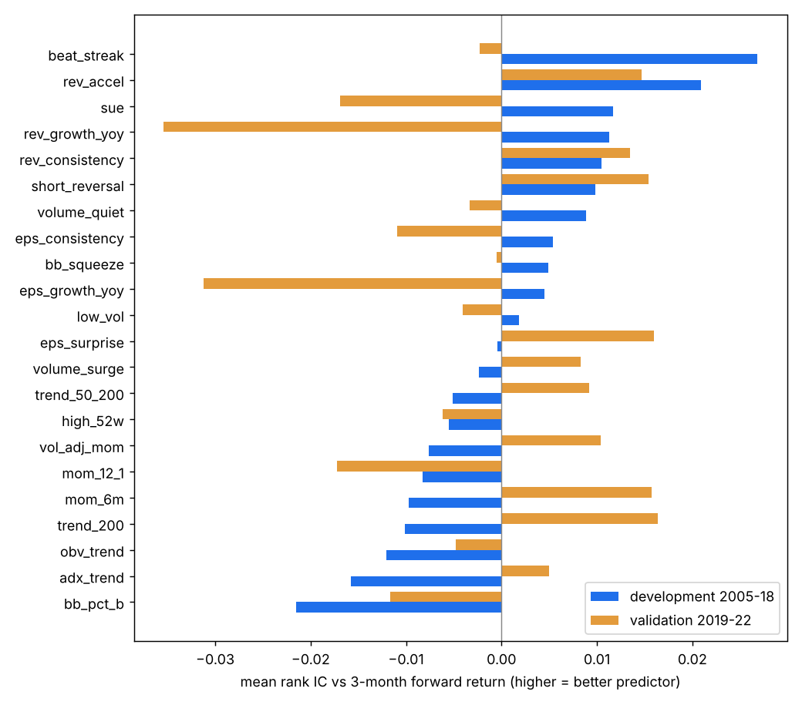

# Factor report — which signals predict next-month returns?

Universe: point-in-time S&P 500 members, price > $5, 20-day dollar volume > $5M (median 317 stocks per month). Forward return: next open → open 21 bars later. Holdout (2023+) not used.

**How to read:** *IC* = how well the factor's ranking predicts the ranking of forward returns (0 = no skill; 0.02–0.05 is a useful real-world edge). *t* > 2 = unlikely to be luck (3-month t is corrected for overlapping windows). *Top-10% edge* = yearly return of the best 10% by the factor minus the average stock — what a ~20-stock buyer of that factor would gain. *EDGE* = significant in development AND the same direction in validation.

| Factor | Group | Dev IC 1m (t) | Dev IC 3m (t) | Dev top-10% edge %/yr (3m) | Val IC 1m | Val IC 3m | Val top-10% edge %/yr (3m) | Coverage % | Verdict |
|---|---|---|---|---|---|---|---|---|---|
| beat_streak | earnings | +0.0237 (+3.4) | +0.0268 (+2.2) | +0.7 | +0.0077 | -0.0023 | -0.6 | 98.9 | EDGE (holds out-of-sample) |
| rev_accel | growth | +0.0114 (+1.4) | +0.0209 (+1.6) | +2.2 | +0.0219 | +0.0147 | +1.2 | 61.0 | noise |
| sue | earnings | +0.0115 (+1.4) | +0.0117 (+0.8) | +0.9 | +0.0049 | -0.0169 | -0.0 | 59.2 | noise |
| rev_growth_yoy | growth | +0.0095 (+0.9) | +0.0113 (+0.6) | +0.2 | -0.0024 | -0.0354 | +0.7 | 63.1 | noise |
| rev_consistency | growth | +0.0074 (+0.7) | +0.0105 (+0.6) | +0.1 | +0.0156 | +0.0135 | -0.9 | 44.0 | noise |
| short_reversal | momentum | +0.0194 (+1.9) | +0.0098 (+0.5) | +0.8 | -0.0176 | +0.0154 | +1.7 | 100.0 | noise |
| volume_quiet | volume | +0.0046 (+0.7) | +0.0089 (+0.8) | +1.5 | -0.0052 | -0.0033 | -1.6 | 99.9 | noise |
| eps_consistency | growth | +0.0058 (+0.6) | +0.0054 (+0.4) | -0.0 | +0.0059 | -0.0109 | -1.4 | 46.5 | noise |
| bb_squeeze | volatility | +0.0157 (+1.1) | +0.0049 (+0.2) | -0.3 | +0.0034 | -0.0005 | -1.6 | 100.0 | noise |
| eps_growth_yoy | growth | +0.0050 (+0.6) | +0.0045 (+0.3) | +0.3 | -0.0041 | -0.0312 | -2.1 | 66.2 | noise |
| low_vol | volatility | +0.0075 (+0.4) | +0.0018 (+0.1) | -1.0 | +0.0012 | -0.0041 | -0.8 | 99.9 | noise |
| eps_surprise | earnings | +0.0058 (+0.9) | -0.0004 (-0.0) | -1.4 | +0.0127 | +0.0160 | -2.0 | 98.9 | noise |
| volume_surge | volume | -0.0023 (-0.3) | -0.0024 (-0.2) | +0.3 | +0.0044 | +0.0083 | -1.3 | 99.9 | noise |
| trend_50_200 | trend | -0.0015 (-0.1) | -0.0051 (-0.2) | -1.0 | -0.0052 | +0.0092 | +0.9 | 99.7 | noise |
| high_52w | momentum | -0.0004 (-0.0) | -0.0055 (-0.2) | -2.4 | +0.0010 | -0.0062 | -2.3 | 99.6 | noise |
| vol_adj_mom | momentum | -0.0011 (-0.1) | -0.0076 (-0.3) | -0.2 | +0.0016 | +0.0104 | +2.3 | 99.8 | noise |
| mom_12_1 | momentum | +0.0047 (+0.3) | -0.0083 (-0.3) | -4.3 | -0.0145 | -0.0172 | +1.0 | 99.6 | noise |
| mom_6m | momentum | -0.0005 (-0.0) | -0.0097 (-0.4) | -0.6 | -0.0015 | +0.0157 | +1.7 | 99.8 | noise |
| trend_200 | trend | -0.0018 (-0.1) | -0.0101 (-0.4) | -1.5 | +0.0017 | +0.0164 | +2.4 | 99.7 | noise |
| obv_trend | volume | -0.0069 (-0.6) | -0.0121 (-0.7) | -0.9 | -0.0199 | -0.0048 | +0.1 | 99.9 | noise |
| adx_trend | trend | -0.0186 (-1.8) | -0.0158 (-0.9) | -1.9 | -0.0176 | +0.0050 | +1.6 | 100.0 | noise |
| bb_pct_b | volatility | -0.0247 (-2.2) | -0.0215 (-1.2) | -2.4 | +0.0040 | -0.0117 | -0.2 | 100.0 | inverse (high score = worse) |

## What each factor measures

- **beat_streak** — How many of the last 4 reports matched or beat the consensus (0-4). `count(reported >= estimate) over the last 4 reports`
- **rev_accel** — Revenue growth speeding up vs the previous quarter. `rev_growth_yoy_q - rev_growth_yoy_q-1`
- **sue** — Standardized unexpected earnings: EPS growth vs its own usual variability. `(EPS_q - EPS_q-4) / std(previous 8 such changes)`
- **rev_growth_yoy** — Latest quarter's revenue vs the same quarter a year earlier. `revenue_q / revenue_q-4 - 1`
- **rev_consistency** — In how many of the last 3 years trailing-12-month revenue grew (0-3). `sum over 3 years of [TTM revenue > TTM revenue a year earlier]`
- **short_reversal** — Last week's loss (short-term dips tend to bounce). `-(close / close[t-5] - 1)`
- **volume_quiet** — Quiet volume (a calm base before a move): the opposite of a surge. `-(SMA(volume, 10) / SMA(volume, 50))`
- **eps_consistency** — In how many of the last 3 years trailing-12-month EPS grew (0-3). `sum over 3 years of [TTM EPS > TTM EPS a year earlier]`
- **bb_squeeze** — Narrow Bollinger Bands (a volatility squeeze). `-(upper - lower) / SMA(20)`
- **eps_growth_yoy** — Latest quarter's diluted EPS vs the same quarter a year earlier. `(EPS_q - EPS_q-4) / max(|EPS_q-4|, 0.05), clipped to +/-5`
- **low_vol** — Calmer stocks (lower 3-month daily volatility). `-std(daily returns, 63)`
- **eps_surprise** — Last quarter's EPS surprise vs the consensus estimate (beat = positive). `(reported EPS - consensus) / |consensus| in %, clipped to +/-100`
- **volume_surge** — Recent volume vs its average ('vol undr' rising): buying interest. `SMA(volume, 5) / SMA(volume, 50)`
- **trend_50_200** — 50-day average vs 200-day average (golden-cross strength). `SMA(50) / SMA(200) - 1`
- **high_52w** — Closeness to the 52-week high (1.0 = at the high). `close / max(high, 252 bars)`
- **vol_adj_mom** — 6-month return per unit of volatility: strong AND smooth. `ROC(126) / (ATR(20) / close)`
- **mom_12_1** — 12-month return excluding the last month (classic momentum). `close[t-21] / close[t-252] - 1`
- **mom_6m** — 6-month return (what production uses). `close / close[t-126] - 1`
- **trend_200** — Distance above the 200-day average. `close / SMA(200) - 1`
- **obv_trend** — On-Balance Volume change over 50 days, scaled by average volume: is volume flowing in on up days? `(OBV - OBV[t-50]) / (50 * SMA(volume, 50))`
- **adx_trend** — Trend strength (ADX 0-100), negative when the trend points down. `ADX(14) if +DI > -DI else -ADX(14)`
- **bb_pct_b** — Position inside the Bollinger Bands (1 = at the upper band). `(close - lower) / (upper - lower), bands = SMA(20) +/- 2 std`

## Redundancy: average rank correlation between factors (development)

Pairs above ~0.7 measure nearly the same thing; combining them adds little.

| | mom_12_1 | mom_6m | vol_adj_mom | high_52w | short_reversal | trend_200 | trend_50_200 | adx_trend | volume_surge | volume_quiet | obv_trend | bb_pct_b | bb_squeeze | low_vol | eps_surprise | beat_streak | sue | eps_growth_yoy | rev_growth_yoy | rev_accel | rev_consistency | eps_consistency |
|---|---|---|---|---|---|---|---|---|---|---|---|---|---|---|---|---|---|---|---|---|---|---|
| mom_12_1 | 1.00 | 0.57 | 0.54 | 0.50 | 0.00 | 0.60 | 0.72 | 0.07 | 0.01 | -0.01 | 0.18 | 0.02 | 0.08 | 0.08 | 0.13 | 0.22 | 0.20 | 0.21 | 0.17 | 0.09 | 0.02 | 0.21 |
| mom_6m | 0.57 | 1.00 | 0.95 | 0.65 | -0.16 | 0.92 | 0.87 | 0.37 | -0.02 | 0.02 | 0.44 | 0.27 | 0.06 | 0.09 | 0.20 | 0.14 | 0.11 | 0.13 | 0.09 | 0.07 | -0.03 | 0.13 |
| vol_adj_mom | 0.54 | 0.95 | 1.00 | 0.70 | -0.17 | 0.89 | 0.83 | 0.39 | -0.02 | 0.03 | 0.46 | 0.29 | 0.11 | 0.16 | 0.18 | 0.14 | 0.12 | 0.13 | 0.08 | 0.08 | 0.00 | 0.16 |
| high_52w | 0.50 | 0.65 | 0.70 | 1.00 | -0.26 | 0.74 | 0.59 | 0.47 | 0.00 | 0.01 | 0.47 | 0.42 | 0.34 | 0.50 | 0.11 | 0.17 | 0.12 | 0.12 | 0.05 | 0.07 | 0.01 | 0.15 |
| short_reversal | 0.00 | -0.16 | -0.17 | -0.26 | 1.00 | -0.22 | -0.00 | -0.36 | -0.01 | -0.00 | -0.20 | -0.73 | 0.03 | -0.00 | -0.05 | -0.01 | 0.02 | -0.02 | -0.03 | -0.00 | 0.00 | -0.01 |
| trend_200 | 0.60 | 0.92 | 0.89 | 0.74 | -0.22 | 1.00 | 0.86 | 0.48 | -0.03 | 0.03 | 0.53 | 0.37 | 0.06 | 0.10 | 0.22 | 0.15 | 0.13 | 0.14 | 0.10 | 0.09 | -0.02 | 0.14 |
| trend_50_200 | 0.72 | 0.87 | 0.83 | 0.59 | -0.00 | 0.86 | 1.00 | 0.15 | 0.01 | -0.00 | 0.30 | 0.05 | 0.08 | 0.10 | 0.18 | 0.16 | 0.15 | 0.15 | 0.11 | 0.09 | -0.02 | 0.15 |
| adx_trend | 0.07 | 0.37 | 0.39 | 0.47 | -0.36 | 0.48 | 0.15 | 1.00 | -0.08 | 0.07 | 0.47 | 0.59 | -0.01 | 0.07 | 0.13 | 0.04 | 0.01 | 0.04 | 0.02 | 0.02 | -0.01 | 0.02 |
| volume_surge | 0.01 | -0.02 | -0.02 | 0.00 | -0.01 | -0.03 | 0.01 | -0.08 | 1.00 | -0.79 | -0.05 | -0.03 | -0.15 | 0.07 | -0.01 | 0.00 | 0.04 | -0.01 | 0.00 | 0.02 | 0.04 | 0.03 |
| volume_quiet | -0.01 | 0.02 | 0.03 | 0.01 | -0.00 | 0.03 | -0.00 | 0.07 | -0.79 | 1.00 | 0.06 | 0.04 | 0.23 | -0.05 | 0.01 | -0.01 | -0.04 | 0.01 | 0.00 | -0.02 | -0.02 | -0.01 |
| obv_trend | 0.18 | 0.44 | 0.46 | 0.47 | -0.20 | 0.53 | 0.30 | 0.47 | -0.05 | 0.06 | 1.00 | 0.34 | 0.05 | 0.10 | 0.13 | 0.04 | 0.04 | 0.08 | 0.02 | 0.02 | -0.02 | 0.08 |
| bb_pct_b | 0.02 | 0.27 | 0.29 | 0.42 | -0.73 | 0.37 | 0.05 | 0.59 | -0.03 | 0.04 | 0.34 | 1.00 | -0.01 | 0.05 | 0.07 | 0.02 | -0.01 | 0.03 | 0.02 | 0.01 | -0.01 | 0.04 |
| bb_squeeze | 0.08 | 0.06 | 0.11 | 0.34 | 0.03 | 0.06 | 0.08 | -0.01 | -0.15 | 0.23 | 0.05 | -0.01 | 1.00 | 0.61 | -0.05 | 0.08 | 0.04 | -0.00 | -0.05 | 0.03 | 0.06 | 0.09 |
| low_vol | 0.08 | 0.09 | 0.16 | 0.50 | -0.00 | 0.10 | 0.10 | 0.07 | 0.07 | -0.05 | 0.10 | 0.05 | 0.61 | 1.00 | -0.08 | 0.10 | 0.03 | 0.00 | -0.08 | 0.03 | 0.09 | 0.07 |
| eps_surprise | 0.13 | 0.20 | 0.18 | 0.11 | -0.05 | 0.22 | 0.18 | 0.13 | -0.01 | 0.01 | 0.13 | 0.07 | -0.05 | -0.08 | 1.00 | 0.32 | 0.10 | 0.16 | 0.05 | 0.06 | -0.05 | 0.01 |
| beat_streak | 0.22 | 0.14 | 0.14 | 0.17 | -0.01 | 0.15 | 0.16 | 0.04 | 0.00 | -0.01 | 0.04 | 0.02 | 0.08 | 0.10 | 0.32 | 1.00 | 0.15 | 0.15 | 0.11 | 0.02 | 0.05 | 0.07 |
| sue | 0.20 | 0.11 | 0.12 | 0.12 | 0.02 | 0.13 | 0.15 | 0.01 | 0.04 | -0.04 | 0.04 | -0.01 | 0.04 | 0.03 | 0.10 | 0.15 | 1.00 | 0.81 | 0.25 | 0.04 | 0.11 | 0.40 |
| eps_growth_yoy | 0.21 | 0.13 | 0.13 | 0.12 | -0.02 | 0.14 | 0.15 | 0.04 | -0.01 | 0.01 | 0.08 | 0.03 | -0.00 | 0.00 | 0.16 | 0.15 | 0.81 | 1.00 | 0.27 | 0.10 | -0.05 | 0.21 |
| rev_growth_yoy | 0.17 | 0.09 | 0.08 | 0.05 | -0.03 | 0.10 | 0.11 | 0.02 | 0.00 | 0.00 | 0.02 | 0.02 | -0.05 | -0.08 | 0.05 | 0.11 | 0.25 | 0.27 | 1.00 | 0.34 | 0.34 | 0.11 |
| rev_accel | 0.09 | 0.07 | 0.08 | 0.07 | -0.00 | 0.09 | 0.09 | 0.02 | 0.02 | -0.02 | 0.02 | 0.01 | 0.03 | 0.03 | 0.06 | 0.02 | 0.04 | 0.10 | 0.34 | 1.00 | -0.06 | -0.11 |
| rev_consistency | 0.02 | -0.03 | 0.00 | 0.01 | 0.00 | -0.02 | -0.02 | -0.01 | 0.04 | -0.02 | -0.02 | -0.01 | 0.06 | 0.09 | -0.05 | 0.05 | 0.11 | -0.05 | 0.34 | -0.06 | 1.00 | 0.22 |
| eps_consistency | 0.21 | 0.13 | 0.16 | 0.15 | -0.01 | 0.14 | 0.15 | 0.02 | 0.03 | -0.01 | 0.08 | 0.04 | 0.09 | 0.07 | 0.01 | 0.07 | 0.40 | 0.21 | 0.11 | -0.11 | 0.22 | 1.00 |
