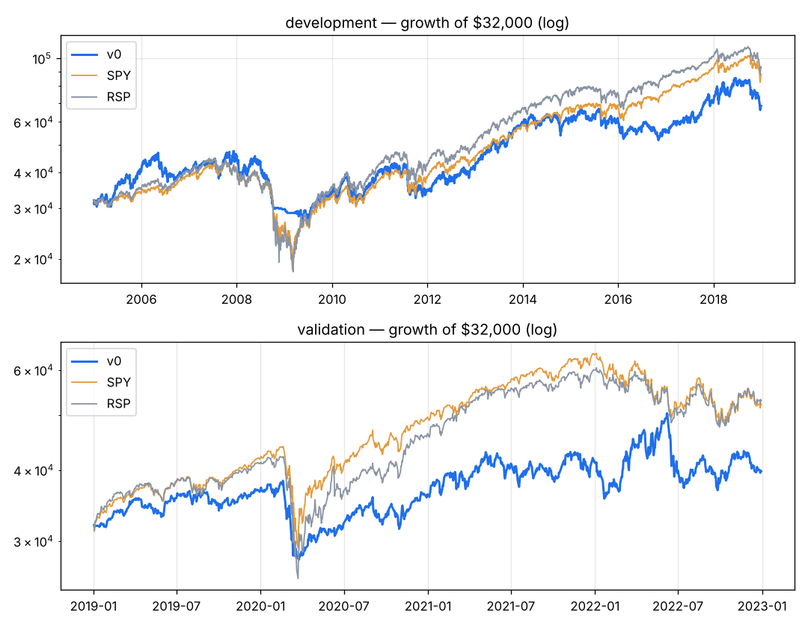

# v0 — Production Growth Momentum Rider (ROC126 > 25% & close > SMA200; exit close < SMA200), restricted to point-in-time S&P 500 members; 20 positions, 1% risk.

Capital $32,000 · next-open fills · 10 bps/side · 20 positions · risk_based sizing · rebalance daily · universe core

**Overfitting flags:** none

## Development 2005–2018

| System | CAGR | Max DD | Sharpe | Calmar | Longest underwater (days) | Trades | Win | Profit factor | Avg hold (bars) | Invested |
|---|---|---|---|---|---|---|---|---|---|---|
| **v0** | +5.6% | -43.1% | 0.37 | 0.13 | 1934 | 590 | 38% | 1.45 | 109 | 94% |
| SPY | +7.5% | -55.1% | 0.48 | 0.14 | 1772 | | | | | |
| RSP | +8.0% | -59.9% | 0.48 | 0.13 | 1299 | | | | | |

**Time travel (12 months from every month-start, 156 starts):** median +6.7%, positive 66% of the time, beat SPY in 44% of starts; worst -34.9%, best +48.2%.
Exit reasons: {'signal': 412, 'stop': 166, 'final': 12}. Longest losing streak: 24 trades.

| Year | 2005 | 2006 | 2007 | 2008 | 2009 | 2010 | 2011 | 2012 | 2013 | 2014 | 2015 | 2016 | 2017 | 2018 |
|---|---|---|---|---|---|---|---|---|---|---|---|---|---|---|
| v0 | +26% | +1% | +13% | -35% | +13% | +19% | -14% | +21% | +44% | +2% | -0% | -9% | +27% | -2% |
| SPY | +5% | +16% | +5% | -37% | +26% | +15% | +2% | +16% | +32% | +13% | +1% | +12% | +22% | -5% |

## Validation 2019–2022

| System | CAGR | Max DD | Sharpe | Calmar | Longest underwater (days) | Trades | Win | Profit factor | Avg hold (bars) | Invested |
|---|---|---|---|---|---|---|---|---|---|---|
| **v0** | +5.6% | -27.4% | 0.35 | 0.21 | 335 | 184 | 38% | 1.39 | 102 | 94% |
| SPY | +13.0% | -33.7% | 0.66 | 0.39 | 360 | | | | | |
| RSP | +13.5% | -39.0% | 0.65 | 0.35 | 359 | | | | | |

**Time travel (12 months from every month-start, 36 starts):** median +2.5%, positive 58% of the time, beat SPY in 22% of starts; worst -20.2%, best +38.3%.
Exit reasons: {'signal': 117, 'stop': 47, 'final': 20}. Longest losing streak: 15 trades.

| Year | 2019 | 2020 | 2021 | 2022 |
|---|---|---|---|---|
| v0 | +15% | -1% | +14% | -4% |
| SPY | +31% | +18% | +29% | -18% |

