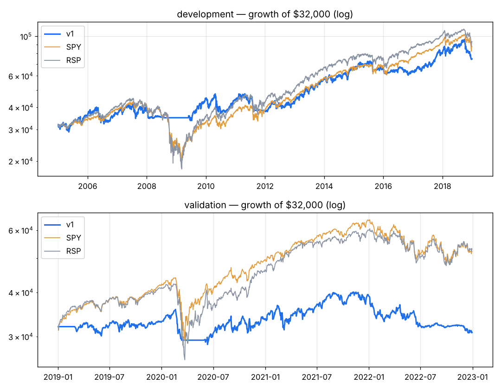

# v1 — Owner's thesis as first written: earnings beats + growth + trend, market filter, indicator confirmation, equal-weighted top 20, monthly.

Capital $32,000 · next-open fills · 10 bps/side · 20 positions · equal_weight sizing · rebalance monthly · universe core

**Score weights:** eps_surprise 1.0, beat_streak 1.0, sue 1.0, rev_growth_yoy 1.0, eps_growth_yoy 0.5, rev_consistency 0.5, eps_consistency 0.5, mom_12_1 1.0, vol_adj_mom 1.0, trend_50_200 0.5, adx_trend 0.25, obv_trend 0.25, volume_surge 0.25
**Buy filters:** market_up=True, stock_above_ma=200
**Sell rules:** ma_break=200, rank_drop=True + catastrophe stop (widest of 20-day swing low / 4.0xATR)

**Overfitting flags:** validation CAGR -1.0% is more than a third below development +6.2%; 17 tuned components (> 15): high risk of fitting noise

## Development 2005–2018

| System | CAGR | Max DD | Sharpe | Calmar | Longest underwater (days) | Trades | Win | Profit factor | Avg hold (bars) | Invested |
|---|---|---|---|---|---|---|---|---|---|---|
| **v1** | +6.2% | -22.9% | 0.46 | 0.27 | 817 | 788 | 41% | 1.54 | 74 | 83% |
| SPY | +7.5% | -55.1% | 0.48 | 0.14 | 1772 | | | | | |
| RSP | +8.0% | -59.9% | 0.48 | 0.13 | 1299 | | | | | |

**Time travel (12 months from every month-start, 156 starts):** median +7.1%, positive 72% of the time, beat SPY in 38% of starts; worst -14.7%, best +33.5%.
Exit reasons: {'signal': 566, 'stop': 220, 'final': 2}. Longest losing streak: 18 trades.

| Year | 2005 | 2006 | 2007 | 2008 | 2009 | 2010 | 2011 | 2012 | 2013 | 2014 | 2015 | 2016 | 2017 | 2018 |
|---|---|---|---|---|---|---|---|---|---|---|---|---|---|---|
| v1 | +10% | +5% | +7% | -12% | +27% | -1% | -12% | +11% | +36% | +14% | +0% | -5% | +27% | -7% |
| SPY | +5% | +16% | +5% | -37% | +26% | +15% | +2% | +16% | +32% | +13% | +1% | +12% | +22% | -5% |

## Validation 2019–2022

| System | CAGR | Max DD | Sharpe | Calmar | Longest underwater (days) | Trades | Win | Profit factor | Avg hold (bars) | Invested |
|---|---|---|---|---|---|---|---|---|---|---|
| **v1** | -1.0% | -23.3% | 0.03 | -0.04 | 416 | 237 | 40% | 0.94 | 64 | 74% |
| SPY | +13.0% | -33.7% | 0.66 | 0.39 | 360 | | | | | |
| RSP | +13.5% | -39.0% | 0.65 | 0.35 | 359 | | | | | |

**Time travel (12 months from every month-start, 36 starts):** median +0.8%, positive 53% of the time, beat SPY in 6% of starts; worst -18.7%, best +28.0%.
Exit reasons: {'signal': 159, 'stop': 58, 'final': 20}. Longest losing streak: 11 trades.

| Year | 2019 | 2020 | 2021 | 2022 |
|---|---|---|---|---|
| v1 | +3% | +2% | +16% | -21% |
| SPY | +31% | +18% | +29% | -18% |

