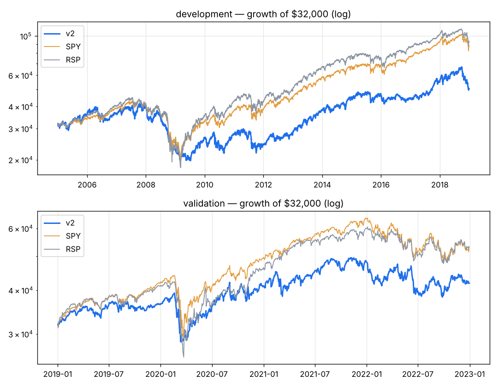

# v2 — v1 without the market filter and with a wide (8xATR) catastrophe stop — development showed 206 of 603 exits were stop-outs (churn) and the filter sat in cash through rebounds.

Capital $32,000 · next-open fills · 10 bps/side · 20 positions · equal_weight sizing · rebalance monthly · universe core

**Score weights:** eps_surprise 1.0, beat_streak 1.0, sue 1.0, rev_growth_yoy 1.0, eps_growth_yoy 0.5, rev_consistency 0.5, eps_consistency 0.5, mom_12_1 1.0, vol_adj_mom 1.0, trend_50_200 0.5, adx_trend 0.25, obv_trend 0.25, volume_surge 0.25
**Buy filters:** stock_above_ma=200
**Sell rules:** ma_break=200, rank_drop=True + catastrophe stop (widest of 20-day swing low / 8.0xATR)

**Overfitting flags:** 16 tuned components (> 15): high risk of fitting noise

## Development 2005–2018

| System | CAGR | Max DD | Sharpe | Calmar | Longest underwater (days) | Trades | Win | Profit factor | Avg hold (bars) | Invested |
|---|---|---|---|---|---|---|---|---|---|---|
| **v2** | +3.3% | -53.1% | 0.27 | 0.06 | 2507 | 1081 | 36% | 1.24 | 62 | 95% |
| SPY | +7.5% | -55.1% | 0.48 | 0.14 | 1772 | | | | | |
| RSP | +8.0% | -59.9% | 0.48 | 0.13 | 1299 | | | | | |

**Time travel (12 months from every month-start, 156 starts):** median +8.6%, positive 68% of the time, beat SPY in 38% of starts; worst -42.5%, best +35.1%.
Exit reasons: {'signal': 1008, 'stop': 62, 'final': 11}. Longest losing streak: 50 trades.

| Year | 2005 | 2006 | 2007 | 2008 | 2009 | 2010 | 2011 | 2012 | 2013 | 2014 | 2015 | 2016 | 2017 | 2018 |
|---|---|---|---|---|---|---|---|---|---|---|---|---|---|---|
| v2 | +10% | +3% | +12% | -44% | +15% | +5% | -13% | +16% | +37% | +16% | +4% | -5% | +25% | -8% |
| SPY | +5% | +16% | +5% | -37% | +26% | +15% | +2% | +16% | +32% | +13% | +1% | +12% | +22% | -5% |

## Validation 2019–2022

| System | CAGR | Max DD | Sharpe | Calmar | Longest underwater (days) | Trades | Win | Profit factor | Avg hold (bars) | Invested |
|---|---|---|---|---|---|---|---|---|---|---|
| **v2** | +7.0% | -27.6% | 0.42 | 0.25 | 416 | 328 | 42% | 1.36 | 59 | 96% |
| SPY | +13.0% | -33.7% | 0.66 | 0.39 | 360 | | | | | |
| RSP | +13.5% | -39.0% | 0.65 | 0.35 | 359 | | | | | |

**Time travel (12 months from every month-start, 36 starts):** median +8.1%, positive 69% of the time, beat SPY in 14% of starts; worst -19.6%, best +45.7%.
Exit reasons: {'signal': 299, 'final': 20, 'stop': 9}. Longest losing streak: 26 trades.

| Year | 2019 | 2020 | 2021 | 2022 |
|---|---|---|---|---|
| v2 | +14% | +13% | +17% | -13% |
| SPY | +31% | +18% | +29% | -18% |

