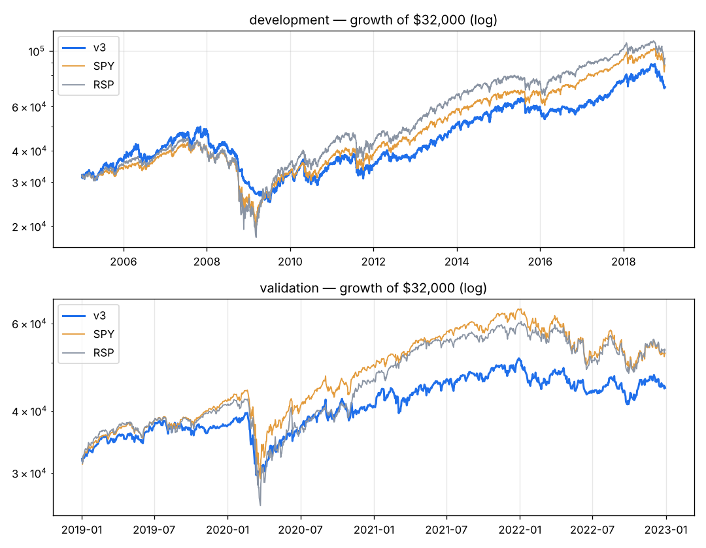

# v3 — Earnings-led: weight only the factors with development evidence (beat streak t=3.4, SUE, revenue acceleration), keep the stock-trend filter, wide stop.

Capital $32,000 · next-open fills · 10 bps/side · 20 positions · equal_weight sizing · rebalance monthly · universe core

**Score weights:** beat_streak 2.0, sue 1.0, rev_accel 1.0, eps_surprise 0.5, rev_consistency 0.5, vol_adj_mom 0.5
**Buy filters:** stock_above_ma=200
**Sell rules:** ma_break=200, rank_drop=True + catastrophe stop (widest of 20-day swing low / 8.0xATR)

**Overfitting flags:** none

## Development 2005–2018

| System | CAGR | Max DD | Sharpe | Calmar | Longest underwater (days) | Trades | Win | Profit factor | Avg hold (bars) | Invested |
|---|---|---|---|---|---|---|---|---|---|---|
| **v3** | +5.9% | -50.1% | 0.43 | 0.12 | 2212 | 1242 | 39% | 1.43 | 54 | 94% |
| SPY | +7.5% | -55.1% | 0.48 | 0.14 | 1772 | | | | | |
| RSP | +8.0% | -59.9% | 0.48 | 0.13 | 1299 | | | | | |

**Time travel (12 months from every month-start, 156 starts):** median +11.3%, positive 77% of the time, beat SPY in 41% of starts; worst -36.8%, best +32.3%.
Exit reasons: {'signal': 1194, 'stop': 39, 'final': 9}. Longest losing streak: 47 trades.

| Year | 2005 | 2006 | 2007 | 2008 | 2009 | 2010 | 2011 | 2012 | 2013 | 2014 | 2015 | 2016 | 2017 | 2018 |
|---|---|---|---|---|---|---|---|---|---|---|---|---|---|---|
| v3 | +13% | +15% | +15% | -38% | +9% | +8% | -2% | +9% | +35% | +16% | -1% | +1% | +27% | -5% |
| SPY | +5% | +16% | +5% | -37% | +26% | +15% | +2% | +16% | +32% | +13% | +1% | +12% | +22% | -5% |

## Validation 2019–2022

| System | CAGR | Max DD | Sharpe | Calmar | Longest underwater (days) | Trades | Win | Profit factor | Avg hold (bars) | Invested |
|---|---|---|---|---|---|---|---|---|---|---|
| **v3** | +8.6% | -25.4% | 0.53 | 0.34 | 365 | 453 | 43% | 1.38 | 42 | 93% |
| SPY | +13.0% | -33.7% | 0.66 | 0.39 | 360 | | | | | |
| RSP | +13.5% | -39.0% | 0.65 | 0.35 | 359 | | | | | |

**Time travel (12 months from every month-start, 36 starts):** median +9.3%, positive 69% of the time, beat SPY in 22% of starts; worst -15.2%, best +42.5%.
Exit reasons: {'signal': 417, 'final': 19, 'stop': 17}. Longest losing streak: 14 trades.

| Year | 2019 | 2020 | 2021 | 2022 |
|---|---|---|---|---|
| v3 | +16% | +10% | +24% | -13% |
| SPY | +31% | +18% | +29% | -18% |

