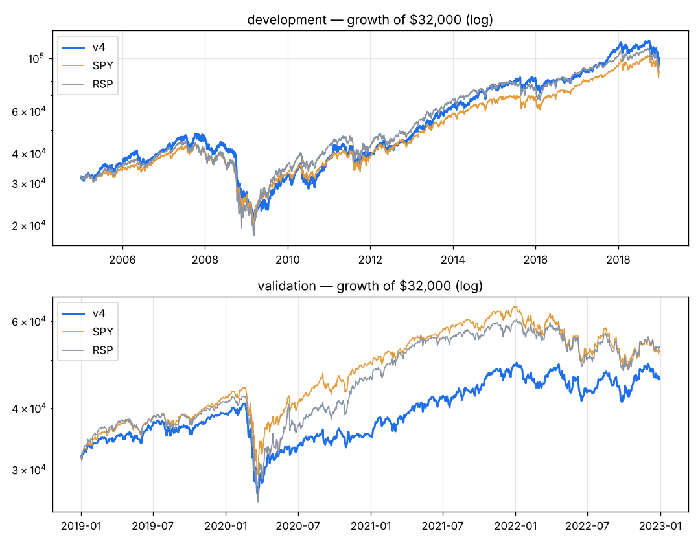

# v4 — Post-earnings drift: buy FRESH big beats (report <= 30 days old) with a beat history, in an uptrend; weekly; exit on rank drop or a 1-year time stop. Motivated by beat_streak's 1-month edge (t=3.4) in development.

Capital $32,000 · next-open fills · 10 bps/side · 20 positions · equal_weight sizing · rebalance weekly · universe core

**Score weights:** surprise_fresh 2.0, beat_streak 1.0, sue 1.0, rev_accel 0.5
**Buy filters:** stock_above_ma=200, beat_last=True
**Sell rules:** rank_drop=True, time_stop=252 + catastrophe stop (widest of 20-day swing low / 8.0xATR)

**Overfitting flags:** none

## Development 2005–2018

| System | CAGR | Max DD | Sharpe | Calmar | Longest underwater (days) | Trades | Win | Profit factor | Avg hold (bars) | Invested |
|---|---|---|---|---|---|---|---|---|---|---|
| **v4** | +8.5% | -55.8% | 0.53 | 0.15 | 1925 | 990 | 56% | 1.64 | 70 | 97% |
| SPY | +7.5% | -55.1% | 0.48 | 0.14 | 1772 | | | | | |
| RSP | +8.0% | -59.9% | 0.48 | 0.13 | 1299 | | | | | |

**Time travel (12 months from every month-start, 156 starts):** median +15.2%, positive 84% of the time, beat SPY in 61% of starts; worst -47.4%, best +49.9%.
Exit reasons: {'signal': 864, 'stop': 106, 'final': 20}. Longest losing streak: 26 trades.

| Year | 2005 | 2006 | 2007 | 2008 | 2009 | 2010 | 2011 | 2012 | 2013 | 2014 | 2015 | 2016 | 2017 | 2018 |
|---|---|---|---|---|---|---|---|---|---|---|---|---|---|---|
| v4 | +11% | +15% | +13% | -41% | +16% | +19% | +5% | +17% | +37% | +21% | +6% | +2% | +31% | -8% |
| SPY | +5% | +16% | +5% | -37% | +26% | +15% | +2% | +16% | +32% | +13% | +1% | +12% | +22% | -5% |

## Validation 2019–2022

| System | CAGR | Max DD | Sharpe | Calmar | Longest underwater (days) | Trades | Win | Profit factor | Avg hold (bars) | Invested |
|---|---|---|---|---|---|---|---|---|---|---|
| **v4** | +9.5% | -35.0% | 0.53 | 0.27 | 433 | 388 | 58% | 1.47 | 51 | 95% |
| SPY | +13.0% | -33.7% | 0.66 | 0.39 | 360 | | | | | |
| RSP | +13.5% | -39.0% | 0.65 | 0.35 | 359 | | | | | |

**Time travel (12 months from every month-start, 36 starts):** median +7.6%, positive 64% of the time, beat SPY in 36% of starts; worst -19.8%, best +41.7%.
Exit reasons: {'signal': 328, 'stop': 40, 'final': 20}. Longest losing streak: 24 trades.

| Year | 2019 | 2020 | 2021 | 2022 |
|---|---|---|---|---|
| v4 | +21% | -10% | +39% | -6% |
| SPY | +31% | +18% | +29% | -18% |

