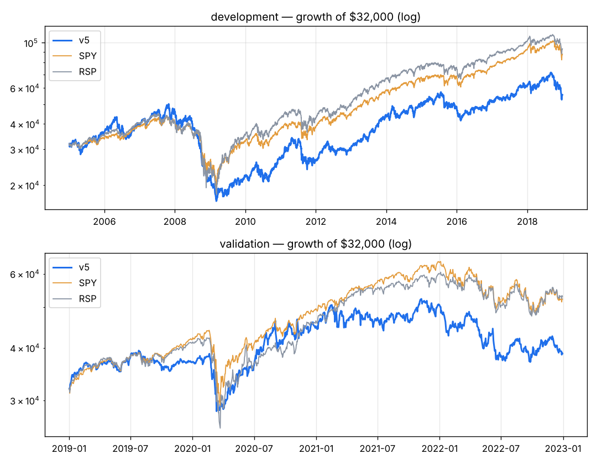

# v5 — v3's best form (MA200 + 1-year time stop) on the EXTENDED universe (+ current S&P 400/600, Nasdaq-100, lists). Survivor-biased: judge it against the extended random control.

Capital $32,000 · next-open fills · 10 bps/side · 20 positions · equal_weight sizing · rebalance monthly · universe extended

**Score weights:** beat_streak 2.0, sue 1.0, rev_accel 1.0, eps_surprise 0.5, rev_consistency 0.5, vol_adj_mom 0.5
**Buy filters:** stock_above_ma=200
**Sell rules:** ma_break=200, time_stop=252 + catastrophe stop (widest of 20-day swing low / 8.0xATR)

**Overfitting flags:** none

## Development 2005–2018

| System | CAGR | Max DD | Sharpe | Calmar | Longest underwater (days) | Trades | Win | Profit factor | Avg hold (bars) | Invested |
|---|---|---|---|---|---|---|---|---|---|---|
| **v5** | +4.0% | -66.6% | 0.30 | 0.06 | 2606 | 836 | 35% | 1.28 | 82 | 97% |
| SPY | +7.5% | -55.1% | 0.48 | 0.14 | 1772 | | | | | |
| RSP | +8.0% | -59.9% | 0.48 | 0.13 | 1299 | | | | | |

**Time travel (12 months from every month-start, 156 starts):** median +12.9%, positive 74% of the time, beat SPY in 44% of starts; worst -58.5%, best +57.8%.
Exit reasons: {'signal': 778, 'stop': 42, 'final': 16}. Longest losing streak: 78 trades.

| Year | 2005 | 2006 | 2007 | 2008 | 2009 | 2010 | 2011 | 2012 | 2013 | 2014 | 2015 | 2016 | 2017 | 2018 |
|---|---|---|---|---|---|---|---|---|---|---|---|---|---|---|
| v5 | +11% | +12% | +16% | -52% | -0% | +22% | -1% | +14% | +46% | +14% | -5% | +7% | +19% | -9% |
| SPY | +5% | +16% | +5% | -37% | +26% | +15% | +2% | +16% | +32% | +13% | +1% | +12% | +22% | -5% |

## Validation 2019–2022

| System | CAGR | Max DD | Sharpe | Calmar | Longest underwater (days) | Trades | Win | Profit factor | Avg hold (bars) | Invested |
|---|---|---|---|---|---|---|---|---|---|---|
| **v5** | +4.9% | -29.2% | 0.32 | 0.17 | 416 | 285 | 32% | 1.24 | 69 | 97% |
| SPY | +13.0% | -33.7% | 0.66 | 0.39 | 360 | | | | | |
| RSP | +13.5% | -39.0% | 0.65 | 0.35 | 359 | | | | | |

**Time travel (12 months from every month-start, 36 starts):** median +5.8%, positive 61% of the time, beat SPY in 19% of starts; worst -21.8%, best +62.8%.
Exit reasons: {'signal': 261, 'final': 20, 'stop': 4}. Longest losing streak: 25 trades.

| Year | 2019 | 2020 | 2021 | 2022 |
|---|---|---|---|---|
| v5 | +16% | +21% | +13% | -23% |
| SPY | +31% | +18% | +29% | -18% |

