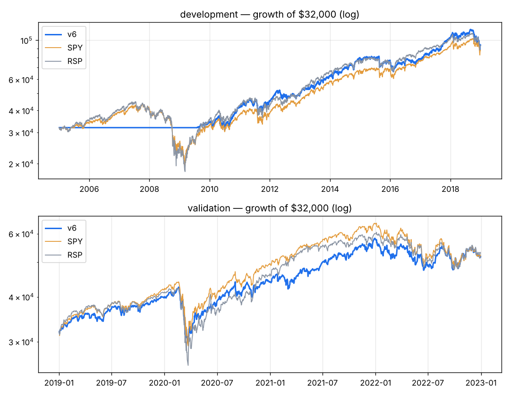

# v6 — v4 without the fresh-surprise factor. Development-only reason: removing it cost 0.5%/yr but cut the development max drawdown from -56% to -24% (criterion 2: max DD <= 35%).

Capital $32,000 · next-open fills · 10 bps/side · 20 positions · equal_weight sizing · rebalance weekly · universe core

**Score weights:** beat_streak 1.0, sue 1.0, rev_accel 0.5
**Buy filters:** stock_above_ma=200, beat_last=True
**Sell rules:** rank_drop=True, time_stop=252 + catastrophe stop (widest of 20-day swing low / 8.0xATR)

**Overfitting flags:** none

## Development 2005–2018

| System | CAGR | Max DD | Sharpe | Calmar | Longest underwater (days) | Trades | Win | Profit factor | Avg hold (bars) | Invested |
|---|---|---|---|---|---|---|---|---|---|---|
| **v6** | +8.0% | -23.7% | 0.67 | 0.34 | 545 | 520 | 59% | 1.92 | 89 | 65% |
| SPY | +7.5% | -55.1% | 0.48 | 0.14 | 1772 | | | | | |
| RSP | +8.0% | -59.9% | 0.48 | 0.13 | 1299 | | | | | |

**Time travel (12 months from every month-start, 156 starts):** median +7.2%, positive 64% of the time, beat SPY in 49% of starts; worst -11.4%, best +46.1%.
Exit reasons: {'signal': 427, 'stop': 73, 'final': 20}. Longest losing streak: 14 trades.

| Year | 2005 | 2006 | 2007 | 2008 | 2009 | 2010 | 2011 | 2012 | 2013 | 2014 | 2015 | 2016 | 2017 | 2018 |
|---|---|---|---|---|---|---|---|---|---|---|---|---|---|---|
| v6 | +0% | +0% | +0% | +0% | +7% | +22% | +8% | +9% | +28% | +24% | -3% | +2% | +33% | -9% |
| SPY | +5% | +16% | +5% | -37% | +26% | +15% | +2% | +16% | +32% | +13% | +1% | +12% | +22% | -5% |

## Validation 2019–2022

| System | CAGR | Max DD | Sharpe | Calmar | Longest underwater (days) | Trades | Win | Profit factor | Avg hold (bars) | Invested |
|---|---|---|---|---|---|---|---|---|---|---|
| **v6** | +12.7% | -30.0% | 0.67 | 0.42 | 365 | 303 | 61% | 1.74 | 65 | 96% |
| SPY | +13.0% | -33.7% | 0.66 | 0.39 | 360 | | | | | |
| RSP | +13.5% | -39.0% | 0.65 | 0.35 | 359 | | | | | |

**Time travel (12 months from every month-start, 36 starts):** median +13.0%, positive 83% of the time, beat SPY in 33% of starts; worst -11.8%, best +44.1%.
Exit reasons: {'signal': 242, 'stop': 41, 'final': 20}. Longest losing streak: 15 trades.

| Year | 2019 | 2020 | 2021 | 2022 |
|---|---|---|---|---|
| v6 | +24% | +11% | +32% | -11% |
| SPY | +31% | +18% | +29% | -18% |

