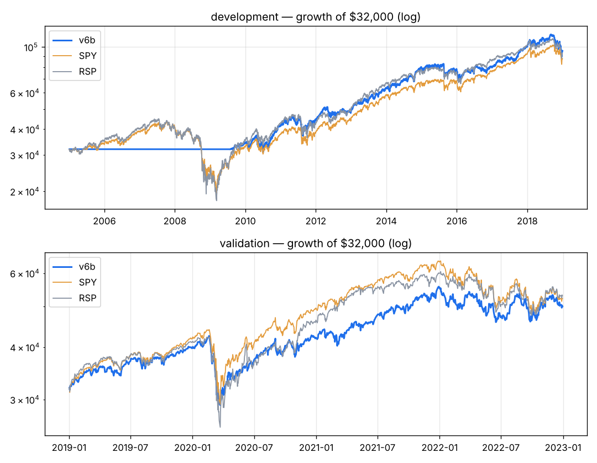

# v6b — v6 with the development-best exit from the v4 SELL tournament (rank drop only, no time stop).

Capital $32,000 · next-open fills · 10 bps/side · 20 positions · equal_weight sizing · rebalance weekly · universe core

**Score weights:** beat_streak 1.0, sue 1.0, rev_accel 0.5
**Buy filters:** stock_above_ma=200, beat_last=True
**Sell rules:** rank_drop=True + catastrophe stop (widest of 20-day swing low / 8.0xATR)

**Overfitting flags:** none

## Development 2005–2018

| System | CAGR | Max DD | Sharpe | Calmar | Longest underwater (days) | Trades | Win | Profit factor | Avg hold (bars) | Invested |
|---|---|---|---|---|---|---|---|---|---|---|
| **v6b** | +8.2% | -21.9% | 0.68 | 0.37 | 545 | 451 | 59% | 2.15 | 102 | 65% |
| SPY | +7.5% | -55.1% | 0.48 | 0.14 | 1772 | | | | | |
| RSP | +8.0% | -59.9% | 0.48 | 0.13 | 1299 | | | | | |

**Time travel (12 months from every month-start, 156 starts):** median +7.3%, positive 65% of the time, beat SPY in 49% of starts; worst -9.5%, best +43.6%.
Exit reasons: {'signal': 369, 'stop': 62, 'final': 20}. Longest losing streak: 9 trades.

| Year | 2005 | 2006 | 2007 | 2008 | 2009 | 2010 | 2011 | 2012 | 2013 | 2014 | 2015 | 2016 | 2017 | 2018 |
|---|---|---|---|---|---|---|---|---|---|---|---|---|---|---|
| v6b | +0% | +0% | +0% | +0% | +7% | +21% | +6% | +11% | +30% | +24% | -2% | +3% | +26% | -4% |
| SPY | +5% | +16% | +5% | -37% | +26% | +15% | +2% | +16% | +32% | +13% | +1% | +12% | +22% | -5% |

## Validation 2019–2022

| System | CAGR | Max DD | Sharpe | Calmar | Longest underwater (days) | Trades | Win | Profit factor | Avg hold (bars) | Invested |
|---|---|---|---|---|---|---|---|---|---|---|
| **v6b** | +11.8% | -31.6% | 0.63 | 0.37 | 365 | 308 | 60% | 1.68 | 64 | 95% |
| SPY | +13.0% | -33.7% | 0.66 | 0.39 | 360 | | | | | |
| RSP | +13.5% | -39.0% | 0.65 | 0.35 | 359 | | | | | |

**Time travel (12 months from every month-start, 36 starts):** median +8.9%, positive 83% of the time, beat SPY in 31% of starts; worst -14.4%, best +42.4%.
Exit reasons: {'signal': 246, 'stop': 42, 'final': 20}. Longest losing streak: 11 trades.

| Year | 2019 | 2020 | 2021 | 2022 |
|---|---|---|---|---|
| v6b | +24% | +6% | +32% | -10% |
| SPY | +31% | +18% | +29% | -18% |

