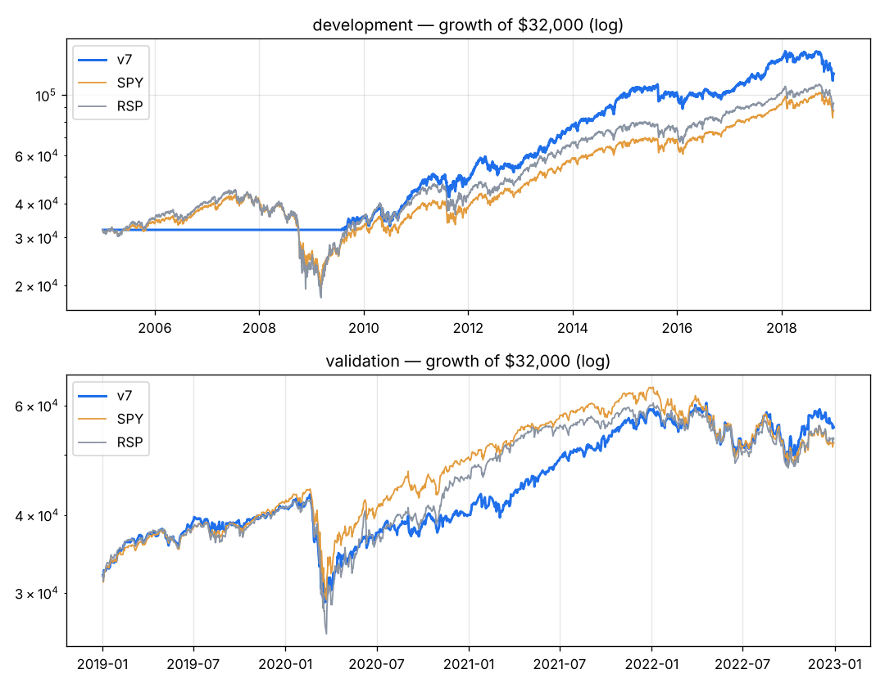

# v7 — Earnings-led, concentrated: beat streak + SUE + revenue acceleration; buy only stocks in an uptrend that beat last quarter; top 10, checked weekly; sell when a holding drops out of the top 30. Chosen from a 767-config search as the centre of a robust plateau (24 neighbours: dev 7.6-10.0% CAGR, -20% to -26% max DD).

Capital $32,000 · next-open fills · 10 bps/side · 10 positions · equal_weight sizing · rebalance weekly · universe core

**Score weights:** beat_streak 1.0, sue 1.0, rev_accel 0.5
**Buy filters:** stock_above_ma=200, beat_last=True
**Sell rules:** rank_drop=True + catastrophe stop (widest of 20-day swing low / 8.0xATR)

**Overfitting flags:** none

## Development 2005–2018

| System | CAGR | Max DD | Sharpe | Calmar | Longest underwater (days) | Trades | Win | Profit factor | Avg hold (bars) | Invested |
|---|---|---|---|---|---|---|---|---|---|---|
| **v7** | +9.9% | -22.2% | 0.77 | 0.45 | 561 | 367 | 67% | 1.94 | 63 | 65% |
| SPY | +7.5% | -55.1% | 0.48 | 0.14 | 1772 | | | | | |
| RSP | +8.0% | -59.9% | 0.48 | 0.13 | 1299 | | | | | |

**Time travel (12 months from every month-start, 156 starts):** median +10.0%, positive 65% of the time, beat SPY in 56% of starts; worst -8.4%, best +49.5%.
Exit reasons: {'signal': 324, 'stop': 33, 'final': 10}. Longest losing streak: 6 trades.

| Year | 2005 | 2006 | 2007 | 2008 | 2009 | 2010 | 2011 | 2012 | 2013 | 2014 | 2015 | 2016 | 2017 | 2018 |
|---|---|---|---|---|---|---|---|---|---|---|---|---|---|---|
| v7 | +0% | +0% | +0% | +0% | +10% | +27% | +8% | +14% | +41% | +29% | +0% | +1% | +32% | -11% |
| SPY | +5% | +16% | +5% | -37% | +26% | +15% | +2% | +16% | +32% | +13% | +1% | +12% | +22% | -5% |

## Validation 2019–2022

| System | CAGR | Max DD | Sharpe | Calmar | Longest underwater (days) | Trades | Win | Profit factor | Avg hold (bars) | Invested |
|---|---|---|---|---|---|---|---|---|---|---|
| **v7** | +14.7% | -32.9% | 0.73 | 0.45 | 340 | 215 | 61% | 1.72 | 46 | 96% |
| SPY | +13.0% | -33.7% | 0.66 | 0.39 | 360 | | | | | |
| RSP | +13.5% | -39.0% | 0.65 | 0.35 | 359 | | | | | |

**Time travel (12 months from every month-start, 36 starts):** median +9.5%, positive 78% of the time, beat SPY in 44% of starts; worst -18.7%, best +48.0%.
Exit reasons: {'signal': 185, 'stop': 20, 'final': 10}. Longest losing streak: 12 trades.

| Year | 2019 | 2020 | 2021 | 2022 |
|---|---|---|---|---|
| v7 | +28% | -2% | +47% | -6% |
| SPY | +31% | +18% | +29% | -18% |

